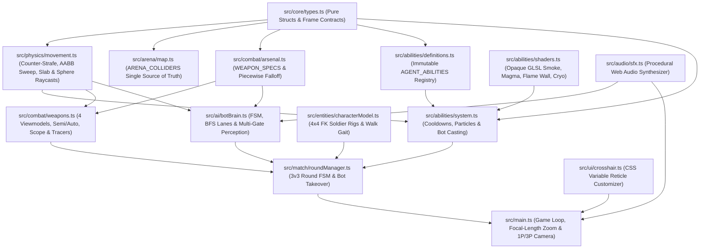

# Chroma Strike — Complete Engineering, Shaders & Mathematics Masterclass

> **Chroma Strike** was built completely from first principles in **TypeScript + Three.js + Custom GLSL + Web Audio** — with zero external black-box game engines, zero texture files, and zero audio asset files. This handbook explains every architectural decision and mathematical construct across all three chapters so you understand every line as if you wrote it yourself.

---

## System Architecture Overview

Before rendering a single polygon, Chroma Strike cleanly separates **pure numeric simulation** (`Vec3`, `AABB`, `PlayerState`, `Combatant`, `WeaponSpec`) from **Three.js visuals & DOM UI**.



### Why This Architecture Scales to Online Multiplayer
- **Deterministic headless physics:** [src/physics/movement.ts](../src/physics/movement.ts) and [src/combat/arsenal.ts](../src/combat/arsenal.ts) never import `three`. An authoritative Node/Bun WebSocket server can run the exact same movement, AABB collision, raycasts, smoke occlusion, and damage math headlessly without a GPU.
- **Registry vs. runtime state separation:** Immutable specs ([AGENT_ABILITIES](../src/abilities/definitions.ts), [WEAPON_SPECS](../src/combat/arsenal.ts)) live separately from live timers and projectiles, keeping network state snapshots tiny.
- **Single source of truth for map geometry:** [ARENA_COLLIDERS](../src/arena/map.ts) generates both the visible 3D walls and the physics/raycast boxes—preventing invisible walls or desynced corners.

---

# Chapter 1 — Movement Physics, Collision & Hitscan Gunplay

## 1.1 Frame-Rate Independent Game Loop & Tunneling Protection
In [src/main.ts](../src/main.ts), `requestAnimationFrame(tick)` measures elapsed seconds between frames:

```ts
const dt = Math.min((now - lastTime) / 1000, 0.05);
```

- Multiplying every velocity and cooldown by `dt` ensures `8.2 m/s` sprint speed feels identical on `60 Hz`, `144 Hz`, and `240 Hz` monitors.
- Clamping `dt <= 0.05` (`50 ms`) prevents **tunneling**: if you switch browser tabs for 4 seconds, physics steps at most `0.05 s` instead of teleporting through a perimeter wall.
- `camera.rotation.order = 'YXZ'` applies horizontal `yaw` around world $+Y$ before vertical `pitch` around local $+X$ (clamped to `[-1.48, 1.48]` radians) so diagonal mouse movement never introduces unwanted screen roll.

## 1.2 3D Look Vectors & Snappy Counter-Strafing ([src/physics/movement.ts](../src/physics/movement.ts))
In Three.js, looking straight ahead at `yaw = 0, pitch = 0` points down `-Z` `(0, 0, -1)`. `getLookDirection(yaw, pitch)` converts Euler look angles into a 3D unit vector:

$$\hat{d}_{\text{look}} = \begin{pmatrix} -\sin(\text{yaw}) \cdot \cos(\text{pitch}) \\ \sin(\text{pitch}) \\ -\cos(\text{yaw}) \cdot \cos(\text{pitch}) \end{pmatrix}$$

For horizontal movement (`updateHorizontalVelocity`), we use an orthonormal ground basis ($\vec{F} = (-\sin\text{yaw}, 0, -\cos\text{yaw})$ and $\vec{R} = (\cos\text{yaw}, 0, -\sin\text{yaw})$), normalize `WASD` input so `W+D` diagonal movement never exceeds `RUN_SPEED = 8.2 m/s`, and apply:
1. **Frame-rate independent exponential friction**: $\vec{v}_{xz} \leftarrow \vec{v}_{xz} \cdot e^{-\text{FRICTION} \cdot \Delta t}$ (`FRICTION = 12`).
2. **Projection acceleration**: $\text{currentSpeed} = \vec{v}_{xz} \cdot \hat{w}$, $\text{addSpeed} = v_{\max} - \text{currentSpeed}$. When you tap `D` while strafing left (`A`), `currentSpeed` is `-8.2 m/s`, making `addSpeed = 16.4 m/s`! High ground acceleration (`ACCEL = 85`) combined with exponential friction drops horizontal velocity below `0.45 m/s` in under **80 ms**, giving crisp *Valorant*-style counter-strafing.

## 1.3 Axis-Separated AABB Wall Sliding (`X` -> `Z` -> `Y`)
Instead of checking `(x, y, z)` all at once, `updatePlayerMovement` advances and resolves **one axis at a time** (with a `1e-5` non-moving axis epsilon inset):
1. Move `X`, resolve overlapping colliders, zero `velocity.x` on hit.
2. Move `Z`, resolve overlapping colliders, zero `velocity.z` on hit — letting you glide smoothly along diagonal walls!
3. Move `Y`, reset `grounded = false`, and set `grounded = true` when `velocity.y <= 0` lands on top of a floor or box (`box.max.y`).

## 1.4 Kay-Kajiya Slab Method (`raycastAABB`) & Headshot Occlusion
Every box is the intersection of 3 orthogonal infinite plane pairs ("slabs" on `X`, `Y`, `Z`). `raycastAABB` computes entry `t1` and exit `t2` per axis:

$$t_{\text{near}} = \max(t_{1x}, t_{1y}, t_{1z}), \qquad t_{\text{far}} = \min(t_{2x}, t_{2y}, t_{2z})$$

A ray hits the box when $t_{\text{near}} \le t_{\text{far}}$ and $0 \le t_{\text{near}} \le d_{\max}$, with surface normal $\pm 1$ along whichever axis set $t_{\text{near}}$.
In [src/combat/weapons.ts](../src/combat/weapons.ts), **Stage A** raycasts against solid `ARENA_COLLIDERS` first to get `closestWallDist`, and **Stage B** checks opposing Head (`y: 1.38..1.82`) and Body (`y: 0..1.38`) hitboxes strictly closer than `closestWallDist`—blocking shots through solid walls while exposing heads over `1.32 m` head-glitch boxes!

---

# Chapter 2 — GLSL Shaders, Ballistics, Particles & Web Audio

## 2.1 Why Alpha-Blended Smoke Was See-Through — And How Opaque GLSL Fixed It ([src/abilities/shaders.ts](../src/abilities/shaders.ts))
Alpha-blended meshes (`transparent: true, opacity: 0.42, depthWrite: false`) evaluate $C_{\text{out}} = 0.42 C_{\text{smoke}} + 0.58 C_{\text{bg}}$ without writing to the hardware Z-buffer—letting 58% of silhouettes behind the smoke bleed through!

`createSmokeDomeMaterial` creates a true *Valorant*-style **opaque hollow sphere**:
1. **Hardware Z-buffer rejection (`transparent: false, depthWrite: true, side: THREE.DoubleSide`)**: Every fragment writes depth `z_ndc` with `alpha = 1.0`, rejecting **100%** of background targets and tracers.
2. **Fresnel Rim vs. `gl_FrontFacing` Hollow Interior**:
   - **Outside (`gl_FrontFacing`)**: Computes view direction $\hat{V} = \text{normalize}(\text{cameraPosition} - \vec{P}_{\text{world}})$ and rim factor $F = (1 - \text{clamp}(|\hat{N}\cdot\hat{V}|, 0, 1))^{2.2}$, highlighting the curved cyan rim over a dark swirling storm core.
   - **Inside (`!gl_FrontFacing`)**: Renders a dark cavernous interior wall (`alpha = 1.0`) so players stepping inside the `4.2 m` pocket can duel inside while seeing 0% of the outside arena!
3. **`smoothstep` Near-Plane Seam Masking** ([src/abilities/system.ts](../src/abilities/system.ts)): Crossing distance $d \approx R$ slices open the `0.1 m` camera near-clip plane. Using Hermite `smoothstep` ($s(u) = 3u^2 - 2u^3$) across `R ± 0.38 m` ramps screen fog to `0.98` opacity right at the polygon boundary and relaxes cleanly to `0.22` inside.
4. **Organic `discard` Dissolve**: During the final `0.45 s`, any fragment whose 3D trigonometric turbulence $n \in [0.04, 0.96]$ exceeds `uDissolve` runs `discard;`, tearing organic holes without ever enabling alpha sorting.

## 2.2 Ray-Sphere Quadratic Discriminant (`raycastSphere`)
To hide overhead HP bars and block AI perception through active smokes, `raycastSphere` in [src/physics/movement.ts](../src/physics/movement.ts) substitutes $\vec{P}(t) = \vec{O} + t\hat{d}$ into $\|\vec{P}(t) - \vec{C}\|^2 = R^2$ ($\vec{m} = \vec{O} - \vec{C}$, $b = \vec{m}\cdot\hat{d}$, $c = \vec{m}\cdot\vec{m} - R^2$):

$$t^2 + 2bt + c = 0 \implies \Delta = b^2 - c, \qquad t = -b \pm \sqrt{b^2 - c}$$

Selecting `tHit = t1 >= 0 ? t1 : t2` handles both rays entering from outside ($t_1 \ge 0$) and rays starting *inside* the sphere ($t_1 < 0 < t_2$).

## 2.3 Voronoi Magma, Flame Wall, Ice Crust & `Float32Array` Particles
- **Procedural 2D Voronoi (`SHARED_VORONOI_GLSL`)**: Measures nearest (`F1`) and second-nearest (`F2`) cell distances across a $3\times 3$ lattice. Where `F2 - F1 -> 0`, two cells meet—forming molten fissures in **Inferno Orb (`Red [E]`)** (`createFireZoneMaterial` + scrolling `0.95 m` `createFlameWallMaterial`) and sharp ice cracks in **Cryo Field (`Blue [E]`)** (`createCryoFieldMaterial` + 14 erupting `ConeGeometry` spikes + jump lock `suppressJump`).
- **Zero-GC `Float32Array` Particle Swirls** (`createParticleStream` / `updateParticleStream` in [src/abilities/system.ts](../src/abilities/system.ts)): Pre-allocates one `Float32Array(count * 3)` wrapped in `THREE.BufferAttribute` and updates rising helical embers & heal motes in place (`needsUpdate = true`) with zero frame garbage collection.

## 2.4 Cubic Ease-Out Dash, Ballistic Reflection & Flash Dot Product
- **Crimson Dash (`Red [Q]`)**: Smoothly decelerates from `30.0 m/s` into `8.2 m/s` sprint speed over `0.24 s`:

$$v(t) = v_{\text{run}} + (v_{\text{peak}} - v_{\text{run}})\left(1 - \frac{t}{T}\right)^{2.2}$$

  paired with a forward 3D wind-streak tunnel and `75° -> 90°` FOV snap.
- **Swept Anti-Tunneling & Specular Wall Reflection** (`stepProjectile`): Sweeps `||v|| * dt + 0.08m` ahead of fast orbs so they never tunnel through thin cover, bouncing off walls with restitution $e$:

$$\vec{v}' = e\Big(\vec{v} - 2(\vec{v}\cdot\hat{n})\hat{n}\Big)$$

- **Pop-Flash (`Green [Q]`) LoS + View Cone**: Warns at `0.42 s`, detonates at `0.65 s` into 3 orthogonal starburst diamonds, checks wall occlusion via `hasLineOfSight`, and uses the **3D Dot Product** $\cos\theta = \hat{d}_{\text{look}} \cdot \hat{u}_{\text{toFlash}}$: looking toward the flash ($\cos\theta > 0.20$) blinds `1.45 s`; flicking away rewards turn-away counterplay with a tiny `0.20 s` glint!

## 2.5 Procedural Web Audio Synthesis ([src/audio/sfx.ts](../src/audio/sfx.ts))
Synthesizes every gunshot, headshot dink (`1046 Hz` C6 + `2093 Hz` C7 partials), reload click, and ability sound on `AudioContext` through a `DynamicsCompressorNode`, shaping envelopes via $A(t) = A_0 e^{-t/\tau}$, pitch-drop sweeps, and biquad `highpass`/`bandpass`/`lowpass` filters over a pre-generated 1s white-noise buffer.

---

# Chapter 3 — 4-Weapon Arsenal, Crosshair Customizer, 3D Person Models & 3v3 AI

## 3.1 Weapon Arsenal & Piecewise Distance Falloff ([src/combat/arsenal.ts](../src/combat/arsenal.ts), [src/combat/weapons.ts](../src/combat/weapons.ts))
1. **Piecewise Linear Falloff (`computeWeaponDamage`)**:

$$t = \text{clamp}\!\left(\frac{d - d_{\text{start}}}{\max(0.01,\, d_{\text{end}} - d_{\text{start}})},\, 0,\, 1\right), \qquad \text{dmg}(d) = \text{round}\!\Big(D_0 \cdot \big(1 - (1 - m_{\min})\,t\big)\Big)$$

2. **Semi-Auto vs. Full-Auto Trigger Gating**: `automatic ? input.fire : Boolean(input.fireJustPressed)` ensures Sidearm (`[1]`) and Rail Sniper (`[4]`) fire once per click while SMG (`[2]`) and AR (`[3]`) spray when held.
3. **Focal-Length Zoomed Sensitivity Scaling** ([src/main.ts](../src/main.ts)): To preserve 1:1 pixel feel across `75°` hipfire, `58°` AR ADS, and `24°` Sniper scope:

$$s_{\text{scoped}} = s_0 \cdot \frac{\tan(\text{FOV}_{\text{curr}} \cdot \pi / 360)}{\tan(75^\circ \cdot \pi / 360)}$$

4. **Distance Sound Attenuation** (`playWeaponShot`): Scales distant bot shots smoothly by $1 / (1 + 0.045 d)$ and adds a `0.28 s` delayed mechanical bolt-rack click-clack to Sniper shots!

## 3.2 Articulated 3D Person Models & `[V]` Camera ([src/entities/characterModel.ts](../src/entities/characterModel.ts))
- **Scene-Graph Forward Kinematics ($4\times 4$ Matrix Tree)**:

$$M_{\text{world}}(\text{weapon}) = M_{\text{root}}(x, y, z, \text{yaw}) \cdot M_{\text{bodyTilt}}(\theta_{\text{death}}) \cdot M_{\text{rightArm}}(\theta_{\text{pitch}} + \theta_{\text{kick}}) \cdot M_{\text{weaponSocket}}$$

  Allies wear Titanium Silver (`0xdce4f2`); Enemies wear Obsidian Charcoal (`0x1b202c`) with crimson edge outlines—both sporting glowing Red/Blue/Green visors, chest cores, and swappable 3D Pistol/SMG/AR/Sniper props!
- **Anti-Phase Sinusoidal Walk Gait**: Swings left & right legs $\pi$ radians out of phase:

$$\theta_{\text{left}} = +A\sin\phi, \qquad \theta_{\text{right}} = -A\sin\phi, \qquad A = \min\!\left(1,\, \frac{\|\vec{v}_{xz}\|}{8.2}\right)\cdot 0.62\text{ rad}$$

- **Wall-Clamped `[V]` 3rd-Person Camera** ([src/main.ts](../src/main.ts)): Anchors `+0.48 m` over the right shoulder (`y + 1.68 m`), casts `raycastAABB` backward up to `2.8 m`, and clamps at `max(0.35, hitDist - 0.25)` so walls never block your character.

## 3.3 3v3 Tactical AI FSM, Multi-Gate Perception & Crosshair Customizer
- **4-State FSM (`advance`, `engage`, `evade_cover`, `blinded`)** ([src/ai/botBrain.ts](../src/ai/botBrain.ts)): Routes across a 27-node BFS lane graph, obeys `updatePlayerMovement` gravity/walls/slows, casts role abilities (`castForBot`), and passes 3 perception gates: `blindTimer <= 0` $\land$ `raycastAABB` wall check $\land$ `raycastSphere` against active `SmokeSphere`s.
- **Shortest-Arc Yaw Wrapping**: Prevents $360^\circ$ boundary spins via:

$$\Delta\psi = \operatorname{atan2}\!\big(\sin(\psi_{\text{target}} - \psi_{\text{bot}}),\; \cos(\psi_{\text{target}} - \psi_{\text{bot}})\big)$$

- **Round Loop (`buy -> combat -> round_end -> match_over`)** ([src/match/roundManager.ts](../src/match/roundManager.ts)): First to 5 wins, with Round 1 Pistols -> Round 2 SMGs -> Rounds 3+ AR/Sniper, `[F1-F3]` Agent switching, and **`[Tab]` Living Ally Bot Takeover**.
- **CSS Variable Crosshair Customizer (`[C]`)** ([src/ui/crosshair.ts](../src/ui/crosshair.ts)): Updates `--ch-color`, `--ch-len`, `--ch-thick`, `--ch-gap`, and `--ch-dot-size` on the parent DOM root in one unified browser style pass and saves presets to `localStorage`.

---

# Chapter 4 — Killhouse Skirmish Map, Live `[M]` Map Maker & Opus Sculpted 3D Agents

## 4.1 2D ASCII Skirmish Pipeline & Coordinate Transform ([src/arena/skirmishAscii.ts](../src/arena/skirmishAscii.ts), [src/arena/map.ts](../src/arena/map.ts))
Rather than hardcoding 80 separate coordinate boxes, Chroma Strike defines its **CoD Killhouse / *Valorant* Skirmish** warehouse as a $14 \times 17$ text grid of $s = 2.0\text{ m}$ tiles (`28 m × 34 m` centered at $(0, 0)$):

$$x_{\text{center}}(c) = -14.0 + (c + 0.5) \cdot 2.0, \qquad z_{\text{center}}(r) = -17.0 + (r + 0.5) \cdot 2.0$$

- `#`: Perimeter wall (`4.20 m`) or interior plywood wall (`3.20 m`)
- `=`: Chest-high head-glitch cover (`1.28 m`, shields torso while exposing the `1.38–1.82 m` head hitbox)
- `B`: Industrial shipping crate (`2.20 m`, full standing cover)
- `P` & `^` / `v`: Central steel Watchtower deck (`0.90 m`) reached via two-step stairs (`0.45 m`)
- `A` / `E` / `.`: Ally (`+Z`) & Enemy (`-Z`) spawn pads and concrete floor (`0.00 m`)

## 4.2 2D Greedy Meshing (`greedyMeshGrid`) & In-Place Single Source of Truth
Scanning row-by-row from top-left to bottom-right, `greedyMeshGrid` expands maximal rectangles ($w \times h$) of unvisited tiles sharing the same `MergeKind` and emits **one combined `AABB` collider** per block — compressing ~85 raw solid tiles into ~25 seamless colliders and eliminating internal seam-snags. `applyGridData` mutates `ARENA_COLLIDERS` strictly in place (`length = 0; push(...)`) so `movement.ts`, `weapons.ts`, `botBrain.ts`, and `map.ts` never go out of sync after a live edit.

## 4.3 Auto-Extracted Nav-Graph, Stair-Stepping (`STEP_HEIGHT = 0.52 m`) & `[M]` Live Map Maker
- **Auto-BFS Waypoints (`extractWaypoints`)**: Converts every walkable cell into an `ArenaWaypoint`, linking orthogonal neighbors when $|h_A - h_B| \le 0.50\text{ m}$ (stairs climb smoothly, `0.90 m` cliffs do not) and linking diagonals only when both shared corner cells also pass the step test.
- **Quake/*Valorant* Stair-Stepping ([src/physics/movement.ts](../src/physics/movement.ts))**: During `X`/`Z` collision resolution, grounded combatants facing a ledge with $0 < \text{box.max.y} - y \le 0.52\text{ m}$ test `canStepUpToY` for ceiling clearance and step cleanly onto `0.45 m` stairs without jumping.
- **`[M]` Live Map Maker ([src/ui/mapEditor.ts](../src/ui/mapEditor.ts))**: Left-click/drag paints brushes (`#`, `=`, `B`, `P`, `^`, `v`, `A`, `E`), right-click erases to `.`, **Apply Live** disposes old GPU meshes (`disposeArenaRoot`), rebuilds `ARENA_COLLIDERS`, waypoints, and spawns, persists to `localStorage`, and **Copy TypeScript Code** exports a drop-in `DEFAULT_KILLHOUSE_GRID` array.

## 4.4 Opus Sculpted 3D Agents: `LatheGeometry`, 70/30 Color Readability & 2-Bone IK ([src/entities/characterModel.ts](../src/entities/characterModel.ts))
- **Two-Channel Hue/Value Separation + `ACESFilmicToneMapping`**: ~70% of each soldier's silhouette (helmet, chest cuirass, pauldrons, thighs, greaves, gauntlets, boots) wears vivid self-illuminated Red (`0xff2244`), Electric Cobalt-Cyan (`0x00a8ff`), or Emerald-Jade (`0x10d464`) armor (`emissiveIntensity: 0.28`), while ~30% (undersuit joints, collar, inner biceps/thighs, gloves, belt) carries Team Value — Pearl-Titanium White (`0xf2f6ff`) for Allies vs. Matte Obsidian (`0x141722`) for Enemies — plus clean ground rings and daylight overcast lighting.
- **Surfaces of Revolution (`THREE.LatheGeometry`)**: Sweeps hand-sculpted Catmull-Rom chest splines (`sliceTorsoLathe`), `taperedCapsuleGeometry` limbs, and Mist's partial-angle cowl (`phiLength = 2π - 1.7`) around $+Y$:

$$(x, y, z) = \big(r(t)\sin\phi,\; y(t),\; r(t)\cos\phi\big)$$

- **Backward-Only Knee FK & Analytic 2-Bone Arm IK (`solveArmIK`)**: Rotating downward leg limbs (`(0, -1, 0)^T`) about $+X$ sends $+\theta$ toward `-Z` (forward) and $-\theta$ toward `+Z` (backward); clamping `kneeL/kneeR <= 0` prevents hyperextension. Meanwhile `solveArmIK` applies the Law of Cosines with elbow pole hints to place both hands accurately onto Pistol, SMG, AR, and Sniper grips at every pitch angle!
