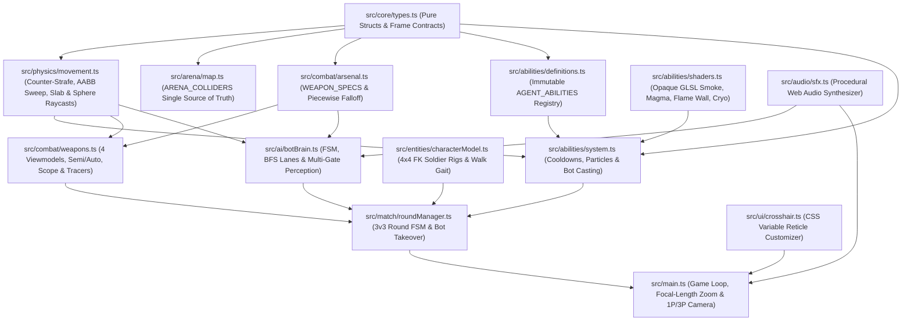

# Chroma Strike — Complete Engineering, Shaders & Mathematics Masterclass

> **Chroma Strike** was built completely from first principles in **TypeScript + Three.js + Custom GLSL + Web Audio** — with zero external black-box game engines, zero texture files, and zero audio asset files. This handbook explains every architectural decision and mathematical construct across all three chapters so you understand every line as if you wrote it yourself.

---

## System Architecture Overview

Before rendering a single polygon, Chroma Strike cleanly separates **pure numeric simulation** (`Vec3`, `AABB`, `PlayerState`, `Combatant`, `WeaponSpec`) from **Three.js visuals & DOM UI**.



### Why This Architecture Scales to Online Multiplayer
- **Deterministic headless physics:** [src/physics/movement.ts](../src/physics/movement.ts) and [src/combat/arsenal.ts](../src/combat/arsenal.ts) never import `three`. An authoritative Node/Bun WebSocket server can run the exact same movement, AABB collision, raycasts, smoke occlusion, and damage math headlessly without a GPU.
- **Registry vs. runtime state separation:** Immutable specs ([AGENT_ABILITIES](../src/abilities/definitions.ts), [WEAPON_SPECS](../src/combat/arsenal.ts)) live separately from live timers and projectiles, keeping network state snapshots tiny.
- **Single source of truth for map geometry:** [ARENA_COLLIDERS](../src/arena/map.ts) generates both the visible 3D walls and the physics/raycast boxes—preventing invisible walls or desynced corners.

---

# Chapter 1 — Movement Physics, Collision & Hitscan Gunplay

## 1.1 Frame-Rate Independent Game Loop & Tunneling Protection
In [src/main.ts](../src/main.ts), `requestAnimationFrame(tick)` measures elapsed seconds between frames:

```ts
const dt = Math.min((now - lastTime) / 1000, 0.05);
```

- Multiplying every velocity and cooldown by `dt` ensures `8.2 m/s` sprint speed feels identical on `60 Hz`, `144 Hz`, and `240 Hz` monitors.
- Clamping `dt <= 0.05` (`50 ms`) prevents **tunneling**: if you switch browser tabs for 4 seconds, physics steps at most `0.05 s` instead of teleporting through a perimeter wall.
- `camera.rotation.order = 'YXZ'` applies horizontal `yaw` around world $+Y$ before vertical `pitch` around local $+X$ (clamped to `[-1.48, 1.48]` radians) so diagonal mouse movement never introduces unwanted screen roll.

## 1.2 3D Look Vectors & Snappy Counter-Strafing ([src/physics/movement.ts](../src/physics/movement.ts))
In Three.js, looking straight ahead at `yaw = 0, pitch = 0` points down `-Z` `(0, 0, -1)`. `getLookDirection(yaw, pitch)` converts Euler look angles into a 3D unit vector:

$$\hat{d}_{\text{look}} = \begin{pmatrix} -\sin(\text{yaw}) \cdot \cos(\text{pitch}) \\ \sin(\text{pitch}) \\ -\cos(\text{yaw}) \cdot \cos(\text{pitch}) \end{pmatrix}$$

For horizontal movement (`updateHorizontalVelocity`), we use an orthonormal ground basis ($\vec{F} = (-\sin\text{yaw}, 0, -\cos\text{yaw})$ and $\vec{R} = (\cos\text{yaw}, 0, -\sin\text{yaw})$), normalize `WASD` input so `W+D` diagonal movement never exceeds `RUN_SPEED = 8.2 m/s`, and apply:
1. **Frame-rate independent exponential friction**: $\vec{v}_{xz} \leftarrow \vec{v}_{xz} \cdot e^{-\text{FRICTION} \cdot \Delta t}$ (`FRICTION = 12`).
2. **Projection acceleration**: $\text{currentSpeed} = \vec{v}_{xz} \cdot \hat{w}$, $\text{addSpeed} = v_{\max} - \text{currentSpeed}$. When you tap `D` while strafing left (`A`), `currentSpeed` is `-8.2 m/s`, making `addSpeed = 16.4 m/s`! High ground acceleration (`ACCEL = 85`) combined with exponential friction drops horizontal velocity below `0.45 m/s` in under **80 ms**, giving crisp *Valorant*-style counter-strafing.

## 1.3 Axis-Separated AABB Wall Sliding (`X` -> `Z` -> `Y`)
Instead of checking `(x, y, z)` all at once, `updatePlayerMovement` advances and resolves **one axis at a time** (with a `1e-5` non-moving axis epsilon inset):
1. Move `X`, resolve overlapping colliders, zero `velocity.x` on hit.
2. Move `Z`, resolve overlapping colliders, zero `velocity.z` on hit — letting you glide smoothly along diagonal walls!
3. Move `Y`, reset `grounded = false`, and set `grounded = true` when `velocity.y <= 0` lands on top of a floor or box (`box.max.y`).

## 1.4 Kay-Kajiya Slab Method (`raycastAABB`) & Headshot Occlusion
Every box is the intersection of 3 orthogonal infinite plane pairs ("slabs" on `X`, `Y`, `Z`). `raycastAABB` computes entry `t1` and exit `t2` per axis:

$$t_{\text{near}} = \max(t_{1x}, t_{1y}, t_{1z}), \qquad t_{\text{far}} = \min(t_{2x}, t_{2y}, t_{2z})$$

A ray hits the box when $t_{\text{near}} \le t_{\text{far}}$ and $0 \le t_{\text{near}} \le d_{\max}$, with surface normal $\pm 1$ along whichever axis set $t_{\text{near}}$.
In [src/combat/weapons.ts](../src/combat/weapons.ts), **Stage A** raycasts against solid `ARENA_COLLIDERS` first to get `closestWallDist`, and **Stage B** checks opposing Head (`y: 1.38..1.82`) and Body (`y: 0..1.38`) hitboxes strictly closer than `closestWallDist`—blocking shots through solid walls while exposing heads over `1.32 m` head-glitch boxes!

---

# Chapter 2 — GLSL Shaders, Ballistics, Particles & Web Audio

## 2.1 Why Alpha-Blended Smoke Was See-Through — And How Opaque GLSL Fixed It ([src/abilities/shaders.ts](../src/abilities/shaders.ts))
Alpha-blended meshes (`transparent: true, opacity: 0.42, depthWrite: false`) evaluate $C_{\text{out}} = 0.42 C_{\text{smoke}} + 0.58 C_{\text{bg}}$ without writing to the hardware Z-buffer—letting 58% of silhouettes behind the smoke bleed through!

`createSmokeDomeMaterial` creates a true *Valorant*-style **opaque hollow sphere**:
1. **Hardware Z-buffer rejection (`transparent: false, depthWrite: true, side: THREE.DoubleSide`)**: Every fragment writes depth `z_ndc` with `alpha = 1.0`, rejecting **100%** of background targets and tracers.
2. **Fresnel Rim vs. `gl_FrontFacing` Hollow Interior**:
   - **Outside (`gl_FrontFacing`)**: Computes view direction $\hat{V} = \text{normalize}(\text{cameraPosition} - \vec{P}_{\text{world}})$ and rim factor $F = (1 - \text{clamp}(|\hat{N}\cdot\hat{V}|, 0, 1))^{2.2}$, highlighting the curved cyan rim over a dark swirling storm core.
   - **Inside (`!gl_FrontFacing`)**: Renders a dark cavernous interior wall (`alpha = 1.0`) so players stepping inside the `4.2 m` pocket can duel inside while seeing 0% of the outside arena!
3. **`smoothstep` Near-Plane Seam Masking** ([src/abilities/system.ts](../src/abilities/system.ts)): Crossing distance $d \approx R$ slices open the `0.1 m` camera near-clip plane. Using Hermite `smoothstep` ($s(u) = 3u^2 - 2u^3$) across `R ± 0.38 m` ramps screen fog to `0.98` opacity right at the polygon boundary and relaxes cleanly to `0.22` inside.
4. **Organic `discard` Dissolve**: During the final `0.45 s`, any fragment whose 3D trigonometric turbulence $n \in [0.04, 0.96]$ exceeds `uDissolve` runs `discard;`, tearing organic holes without ever enabling alpha sorting.

## 2.2 Ray-Sphere Quadratic Discriminant (`raycastSphere`)
To hide overhead HP bars and block AI perception through active smokes, `raycastSphere` in [src/physics/movement.ts](../src/physics/movement.ts) substitutes $\vec{P}(t) = \vec{O} + t\hat{d}$ into $\|\vec{P}(t) - \vec{C}\|^2 = R^2$ ($\vec{m} = \vec{O} - \vec{C}$, $b = \vec{m}\cdot\hat{d}$, $c = \vec{m}\cdot\vec{m} - R^2$):

$$t^2 + 2bt + c = 0 \implies \Delta = b^2 - c, \qquad t = -b \pm \sqrt{b^2 - c}$$

Selecting `tHit = t1 >= 0 ? t1 : t2` handles both rays entering from outside ($t_1 \ge 0$) and rays starting *inside* the sphere ($t_1 < 0 < t_2$).

## 2.3 Voronoi Magma, Flame Wall, Ice Crust & `Float32Array` Particles
- **Procedural 2D Voronoi (`SHARED_VORONOI_GLSL`)**: Measures nearest (`F1`) and second-nearest (`F2`) cell distances across a $3\times 3$ lattice. Where `F2 - F1 -> 0`, two cells meet—forming molten fissures in **Inferno Orb (`Red [E]`)** (`createFireZoneMaterial` + scrolling `0.95 m` `createFlameWallMaterial`) and sharp ice cracks in **Cryo Field (`Blue [E]`)** (`createCryoFieldMaterial` + 14 erupting `ConeGeometry` spikes + jump lock `suppressJump`).
- **Zero-GC `Float32Array` Particle Swirls** (`createParticleStream` / `updateParticleStream` in [src/abilities/system.ts](../src/abilities/system.ts)): Pre-allocates one `Float32Array(count * 3)` wrapped in `THREE.BufferAttribute` and updates rising helical embers & heal motes in place (`needsUpdate = true`) with zero frame garbage collection.

## 2.4 Cubic Ease-Out Dash, Ballistic Reflection & Flash Dot Product
- **Crimson Dash (`Red [Q]`)**: Smoothly decelerates from `30.0 m/s` into `8.2 m/s` sprint speed over `0.24 s`:

$$v(t) = v_{\text{run}} + (v_{\text{peak}} - v_{\text{run}})\left(1 - \frac{t}{T}\right)^{2.2}$$

  paired with a forward 3D wind-streak tunnel and `75° -> 90°` FOV snap.
- **Swept Anti-Tunneling & Specular Wall Reflection** (`stepProjectile`): Sweeps `||v|| * dt + 0.08m` ahead of fast orbs so they never tunnel through thin cover, bouncing off walls with restitution $e$:

$$\vec{v}' = e\Big(\vec{v} - 2(\vec{v}\cdot\hat{n})\hat{n}\Big)$$

- **Pop-Flash (`Green [Q]`) LoS + View Cone**: Warns at `0.42 s`, detonates at `0.65 s` into 3 orthogonal starburst diamonds, checks wall occlusion via `hasLineOfSight`, and uses the **3D Dot Product** $\cos\theta = \hat{d}_{\text{look}} \cdot \hat{u}_{\text{toFlash}}$: looking toward the flash ($\cos\theta > 0.20$) blinds `1.45 s`; flicking away rewards turn-away counterplay with a tiny `0.20 s` glint!

## 2.5 Procedural Web Audio Synthesis ([src/audio/sfx.ts](../src/audio/sfx.ts))
Synthesizes every gunshot, headshot dink (`1046 Hz` C6 + `2093 Hz` C7 partials), reload click, and ability sound on `AudioContext` through a `DynamicsCompressorNode`, shaping envelopes via $A(t) = A_0 e^{-t/\tau}$, pitch-drop sweeps, and biquad `highpass`/`bandpass`/`lowpass` filters over a pre-generated 1s white-noise buffer.

---

# Chapter 3 — 4-Weapon Arsenal, Crosshair Customizer, 3D Person Models & 3v3 AI

## 3.1 Weapon Arsenal & Piecewise Distance Falloff ([src/combat/arsenal.ts](../src/combat/arsenal.ts), [src/combat/weapons.ts](../src/combat/weapons.ts))
1. **Piecewise Linear Falloff (`computeWeaponDamage`)**:

$$t = \text{clamp}\!\left(\frac{d - d_{\text{start}}}{\max(0.01,\, d_{\text{end}} - d_{\text{start}})},\, 0,\, 1\right), \qquad \text{dmg}(d) = \text{round}\!\Big(D_0 \cdot \big(1 - (1 - m_{\min})\,t\big)\Big)$$

2. **Semi-Auto vs. Full-Auto Trigger Gating**: `automatic ? input.fire : Boolean(input.fireJustPressed)` ensures Sidearm (`[1]`) and Rail Sniper (`[4]`) fire once per click while SMG (`[2]`) and AR (`[3]`) spray when held.
3. **Focal-Length Zoomed Sensitivity Scaling** ([src/main.ts](../src/main.ts)): To preserve 1:1 pixel feel across `75°` hipfire, `58°` AR ADS, and `24°` Sniper scope:

$$s_{\text{scoped}} = s_0 \cdot \frac{\tan(\text{FOV}_{\text{curr}} \cdot \pi / 360)}{\tan(75^\circ \cdot \pi / 360)}$$

4. **Distance Sound Attenuation** (`playWeaponShot`): Scales distant bot shots smoothly by $1 / (1 + 0.045 d)$ and adds a `0.28 s` delayed mechanical bolt-rack click-clack to Sniper shots!

## 3.2 Articulated 3D Person Models & `[V]` Camera ([src/entities/characterModel.ts](../src/entities/characterModel.ts))
- **Scene-Graph Forward Kinematics ($4\times 4$ Matrix Tree)**:

$$M_{\text{world}}(\text{weapon}) = M_{\text{root}}(x, y, z, \text{yaw}) \cdot M_{\text{bodyTilt}}(\theta_{\text{death}}) \cdot M_{\text{rightArm}}(\theta_{\text{pitch}} + \theta_{\text{kick}}) \cdot M_{\text{weaponSocket}}$$

  Allies wear Titanium Silver (`0xdce4f2`); Enemies wear Obsidian Charcoal (`0x1b202c`) with crimson edge outlines—both sporting glowing Red/Blue/Green visors, chest cores, and swappable 3D Pistol/SMG/AR/Sniper props!
- **Anti-Phase Sinusoidal Walk Gait**: Swings left & right legs $\pi$ radians out of phase:

$$\theta_{\text{left}} = +A\sin\phi, \qquad \theta_{\text{right}} = -A\sin\phi, \qquad A = \min\!\left(1,\, \frac{\|\vec{v}_{xz}\|}{8.2}\right)\cdot 0.62\text{ rad}$$

- **Wall-Clamped `[V]` 3rd-Person Camera** ([src/main.ts](../src/main.ts)): Anchors `+0.48 m` over the right shoulder (`y + 1.68 m`), casts `raycastAABB` backward up to `2.8 m`, and clamps at `max(0.35, hitDist - 0.25)` so walls never block your character.

## 3.3 3v3 Tactical AI FSM, Multi-Gate Perception & Crosshair Customizer
- **4-State FSM (`advance`, `engage`, `evade_cover`, `blinded`)** ([src/ai/botBrain.ts](../src/ai/botBrain.ts)): Routes across a 27-node BFS lane graph, obeys `updatePlayerMovement` gravity/walls/slows, casts role abilities (`castForBot`), and passes 3 perception gates: `blindTimer <= 0` $\land$ `raycastAABB` wall check $\land$ `raycastSphere` against active `SmokeSphere`s.
- **Shortest-Arc Yaw Wrapping**: Prevents $360^\circ$ boundary spins via:

$$\Delta\psi = \operatorname{atan2}\!\big(\sin(\psi_{\text{target}} - \psi_{\text{bot}}),\; \cos(\psi_{\text{target}} - \psi_{\text{bot}})\big)$$

- **Round Loop (`buy -> combat -> round_end -> match_over`)** ([src/match/roundManager.ts](../src/match/roundManager.ts)): First to 5 wins, with Round 1 Pistols -> Round 2 SMGs -> Rounds 3+ AR/Sniper, `[F1-F3]` Agent switching, and **`[Tab]` Living Ally Bot Takeover**.
- **CSS Variable Crosshair Customizer (`[C]`)** ([src/ui/crosshair.ts](../src/ui/crosshair.ts)): Updates `--ch-color`, `--ch-len`, `--ch-thick`, `--ch-gap`, and `--ch-dot-size` on the parent DOM root in one unified browser style pass and saves presets to `localStorage`.

---

# Chapter 4 — Killhouse Skirmish Map, Live `[M]` Map Maker & Opus Sculpted 3D Agents

## 4.1 2D ASCII Skirmish Pipeline & Coordinate Transform ([src/arena/skirmishAscii.ts](../src/arena/skirmishAscii.ts), [src/arena/map.ts](../src/arena/map.ts))
Rather than hardcoding 80 separate coordinate boxes, Chroma Strike defines its **CoD Killhouse / *Valorant* Skirmish** warehouse as a $14 \times 17$ text grid of $s = 2.0\text{ m}$ tiles (`28 m × 34 m` centered at $(0, 0)$):

$$x_{\text{center}}(c) = -14.0 + (c + 0.5) \cdot 2.0, \qquad z_{\text{center}}(r) = -17.0 + (r + 0.5) \cdot 2.0$$

- `#`: Perimeter wall (`4.20 m`) or interior plywood wall (`3.20 m`)
- `=`: Chest-high head-glitch cover (`1.28 m`, shields torso while exposing the `1.38–1.82 m` head hitbox)
- `B`: Industrial shipping crate (`2.20 m`, full standing cover)
- `P` & `^` / `v`: Central steel Watchtower deck (`0.90 m`) reached via two-step stairs (`0.45 m`)
- `A` / `E` / `.`: Ally (`+Z`) & Enemy (`-Z`) spawn pads and concrete floor (`0.00 m`)

## 4.2 2D Greedy Meshing (`greedyMeshGrid`) & In-Place Single Source of Truth
Scanning row-by-row from top-left to bottom-right, `greedyMeshGrid` expands maximal rectangles ($w \times h$) of unvisited tiles sharing the same `MergeKind` and emits **one combined `AABB` collider** per block — compressing ~85 raw solid tiles into ~25 seamless colliders and eliminating internal seam-snags. `applyGridData` mutates `ARENA_COLLIDERS` strictly in place (`length = 0; push(...)`) so `movement.ts`, `weapons.ts`, `botBrain.ts`, and `map.ts` never go out of sync after a live edit.

## 4.3 Auto-Extracted Nav-Graph, Stair-Stepping (`STEP_HEIGHT = 0.52 m`) & `[M]` Live Map Maker
- **Auto-BFS Waypoints (`extractWaypoints`)**: Converts every walkable cell into an `ArenaWaypoint`, linking orthogonal neighbors when $|h_A - h_B| \le 0.50\text{ m}$ (stairs climb smoothly, `0.90 m` cliffs do not) and linking diagonals only when both shared corner cells also pass the step test.
- **Quake/*Valorant* Stair-Stepping ([src/physics/movement.ts](../src/physics/movement.ts))**: During `X`/`Z` collision resolution, grounded combatants facing a ledge with $0 < \text{box.max.y} - y \le 0.52\text{ m}$ test `canStepUpToY` for ceiling clearance and step cleanly onto `0.45 m` stairs without jumping.
- **`[M]` Live Map Maker ([src/ui/mapEditor.ts](../src/ui/mapEditor.ts))**: Left-click/drag paints brushes (`#`, `=`, `B`, `P`, `^`, `v`, `A`, `E`), right-click erases to `.`, **Apply Live** disposes old GPU meshes (`disposeArenaRoot`), rebuilds `ARENA_COLLIDERS`, waypoints, and spawns, persists to `localStorage`, and **Copy TypeScript Code** exports a drop-in `DEFAULT_KILLHOUSE_GRID` array.

## 4.4 Opus Sculpted 3D Agents: `LatheGeometry`, 70/30 Color Readability & 2-Bone IK ([src/entities/characterModel.ts](../src/entities/characterModel.ts))
- **Two-Channel Hue/Value Separation + `ACESFilmicToneMapping`**: ~70% of each soldier's silhouette (helmet, chest cuirass, pauldrons, thighs, greaves, gauntlets, boots) wears vivid self-illuminated Red (`0xff2244`), Electric Cobalt-Cyan (`0x00a8ff`), or Emerald-Jade (`0x10d464`) armor (`emissiveIntensity: 0.28`), while ~30% (undersuit joints, collar, inner biceps/thighs, gloves, belt) carries Team Value — Pearl-Titanium White (`0xf2f6ff`) for Allies vs. Matte Obsidian (`0x141722`) for Enemies — plus clean ground rings and daylight overcast lighting.
- **Surfaces of Revolution (`THREE.LatheGeometry`)**: Sweeps hand-sculpted Catmull-Rom chest splines (`sliceTorsoLathe`), `taperedCapsuleGeometry` limbs, and Mist's partial-angle cowl (`phiLength = 2π - 1.7`) around $+Y$:

$$(x, y, z) = \big(r(t)\sin\phi,\; y(t),\; r(t)\cos\phi\big)$$

- **Backward-Only Knee FK & Analytic 2-Bone Arm IK (`solveArmIK`)**: Rotating downward leg limbs (`(0, -1, 0)^T`) about $+X$ sends $+\theta$ toward `-Z` (forward) and $-\theta$ toward `+Z` (backward); clamping `kneeL/kneeR <= 0` prevents hyperextension. Meanwhile `solveArmIK` applies the Law of Cosines with elbow pole hints to place both hands accurately onto Pistol, SMG, AR, and Sniper grips at every pitch angle!

---

# Chapter 5 — Indie Production Polish: Z-Fighting Elimination, 3D Agent Select & Umbra + Volt

## 5.1 Hardware Depth-Buffer Quantization & Fixing Wall Flashing ([src/arena/map.ts](../src/arena/map.ts), [src/combat/weapons.ts](../src/combat/weapons.ts))
In a perspective frustum ($n = 0.05$, $f = 150$), view-space depth $z_e$ maps hyperbolically to Normalized Device Coordinates before 24-bit integer quantization:

$$z_{\text{ndc}}(z_e) = \frac{f + n}{f - n} - \frac{2\,f\,n}{(f - n)\,z_e}$$

When `wall_interior` steel framing posts shared identical `min.z`, `max.z`, and `0..3.10` Y bounds with plywood panels, distant depth precision collapsed below floating-point rounding — causing walls to flicker/flash as the camera moved. Three complementary fixes eliminate flashing completely:
1. **True Geometric Relief (`+1.2 cm` / `+0.8 cm`)**: Interior steel framing posts protrude `0.012 m` proud of plywood faces with `0.004..3.096 m` vertical clearance; trims/caprails/crate bands extend `+0.008 m` proud with `0.004 m` vertical overlap; purlin rafters inset `0.02 m` cleanly above trusses.
2. **Hardware Polygon Depth Bias (`polygonOffset`)**: Block/floor `MeshStandardMaterial`s apply `(factor = +1, units = +1)` so `EdgesGeometry` never stipples, while floor ability decals and bullet impact rings (`0.024 m` normal offset) apply `(-2, -2)` plus `(zoneSeq % 8) * 0.0015 m` Y-stagger:

$$\Delta z_{\text{bias}} = \text{factor} \cdot \max\!\left(\left|\frac{\partial z}{\partial x}\right|, \left|\frac{\partial z}{\partial y}\right|\right) + \text{units} \cdot r$$

3. **Wall-Proximity Viewmodel Tuck**: A short `0.95 m` forward raycast smoothly retracts first-person rifle/sniper viewmodels along `+Z` (up to `+0.34 m`) next to tight cover so gun barrels never clip through concrete.

## 5.2 Two New Agents — Physics & Custom GLSL ([src/abilities/system.ts](../src/abilities/system.ts), [src/abilities/shaders.ts](../src/abilities/shaders.ts))
- **`violet` — Umbra (Shadow Smoker / Controller)**:
  - **`[Q]` Void Shroud (2 Charges, `14 s`)**: Fires a zero-drop linear phase bolt (`32 m/s`, auto-blooms at `0.50 s` or wall impact) that you can **re-tap `[Q]` mid-flight** to bloom early without spending a second charge! Uses `createVoidSmokeMaterial` (double domain-warped `voidNebula` turbulence with full `depthWrite: true` + `discard` dissolve).
  - **`[E]` Singularity (`13 s`)**: Spawns a `4.0 m / 3.2 s` accretion vortex (`createSingularityMaterial` differential rotation $\theta' = \theta + 2.5/(r + 0.15) + 3t$ around a black event horizon). Pulls opposing targets inward (`externalVelocity` up to `3.2 m/s` resolved through X/Z AABB wall sliding in [movement.ts](../src/physics/movement.ts)), locks jump, and applies **`1.25x` Fragile** incoming damage.
- **`gold` — Volt (Neon-Style Electric Duelist)**:
  - **`[Q]` Overdrive Slide (`11 s`)**: `4.5 s` overdrive sprint (`1.45x` = `11.89 m/s`). Pressing `Shift` or tapping `[Q]` while moving fires a `0.55 s` **Electric Power-Slide** (`14.2 -> 7.8 m/s` cubic ease-out, `-0.68 m` camera eye dip, `85°` FOV + `-0.038 rad` tilt, `1.22 m` crouched collision + `-0.50 m` ducked hitboxes underneath `1.28 m` barriers, and `moveSpreadMultiplier = 0` for pinpoint slide-shooting!).
  - **`[E]` Relay Bolt (`10 s`)**: `34 m/s` 1-bounce bolt (`restitution = 0.92`) spawning dual `3.2 m` crackling lightning shock zones (`createElectricRelayMaterial`, ridged FBM $\big(1 - |n|\big)^8$ quantized at 20 Hz) at both **Bounce #1** and **Impact #2** (`22` damage + `2.0 s` Concuss: `0.60x` speed, `0.68x` fire rate, `1.45x` spread/slew).

## 5.3 Live 3D Agent Select Stage, Opus Sculpted Rigs & Fair AI ([src/ui/agentSelect.ts](../src/ui/agentSelect.ts), [src/ai/botBrain.ts](../src/ai/botBrain.ts))
- **Secondary-Renderer 3D Agent Select Stage (`[B]`)**: Dedicated `WebGLRenderer` with 3-point rim lights showcasing any of the 5 live spinning `CharacterRig`s (including **Umbra**'s `1.6π` hooded cowl + out-of-phase spine censer vials + rippling veils and **Volt**'s dorsal `TorusKnotGeometry` lightning coils + pooled `THREE.Line` sprint arcs + low Power-Slide 3rd-person pose) — rendering **only while open** for zero gameplay FPS overhead.
- **Casual / Tactical / Pro AI + Non-Duplicate 5-Agent 3v3 Draft + Game Feel**: Default `Casual` AI (`0.45 s` reaction, `3.8 rad/s` slew, `+1.08 m` chest aim, forgiving bursts) keeps solo matches welcoming; non-duplicate 3v3 squads draft from all 5 agents every round; camera-relative `atan2` directional damage arcs, `x2`/`x3` Kill Medals, `140 ms` jump/trigger input buffers, and low-ammo magazine clicks complete the indie studio polish!

---

# Chapter 6 — Search & Destroy, *Valorant/CS* Economy & Multi-Band 2-Site Map

## 6.1 Multi-Band Greedy Meshing (`W` Windows & `O` Archways) ([src/arena/skirmishAscii.ts](../src/arena/skirmishAscii.ts), [src/arena/map.ts](../src/arena/map.ts))
Upgrading the arena to a `24 × 28` (`48 m × 56 m`) 2-Site Search & Destroy compound replaces single scalar wall heights with vertical collider bands (`TileColliderSpec.bands`):

$$\text{Colliders}(k) = \Big\{ [x_0, x_1] \times [y_0, y_1] \times [z_0, z_1] \;\Big|\; [y_0, y_1] \in \text{MERGE\_SPECS}[k].\text{bands} \Big\}$$

- **`W` Shoot-Through Windows (`[0..1.12m]` sill + `[2.55..3.60m]` lintel)**: Bullets, sniper scopes, flashes, smokes, and Relay Bolts fly cleanly across the open $1.43\text{ m}$ aperture.
- **`O` Archways (`[2.65..3.60m]` overhead header)**, **`D` Double-Stacked Crates (`1.72 m`)**, **`=` Head-Glitches (`1.26 m`)**, and **`B` Tall Crates (`2.25 m`)** frame a `46 m` **A-Long** sightline, **Mid Window/Catwalk**, West & East **Lurk Connectors**, **Site A (`1`)**, and **Site B (`2`)** (`88` greedy-meshed AABBs, all `444` walkable tiles connected via BFS).

## 6.2 Search & Destroy FSM & Permanent `50%` Defuse Checkpoint ([src/match/roundManager.ts](../src/match/roundManager.ts), [src/entities/spikeModel.ts](../src/entities/spikeModel.ts))
- **`3.0 s` `[F]` Plant -> `45.0 s` Post-Plant**: Arms the 3D Radianite Spike on Site `A` or `B`, resets `phaseTimerSec = 45.0`, and forces retakes even if all Attackers fall (`aliveAttackers === 0 && spikeStatus !== 'planted'`). Beep cadence compresses via $\Delta t = \text{clamp}(t/45,\, 0.12,\, 1.0)$.
- **`5.0 s` `[F]` Defuse w/ `50%` Checkpoint**: Crossing `0.50` locks `spikeHalfwayCheckpoint = true` permanently so Defenders can release to duel and stick the remaining half later.
- **Halftime Side Swap (After Round 5)**: Swaps Attackers (South `+Z`, `z >= +20` buy fence) and Defenders (North `-Z`, `z <= -20` buy fence) cleanly and resets credits to `800¤`.

## 6.3 *Valorant/CS* Financial Recurrence, Delta Shields & Minimap ([src/match/economy.ts](../src/match/economy.ts), [src/ui/buyMenu.ts](../src/ui/buyMenu.ts), [src/ui/minimap.ts](../src/ui/minimap.ts))
$$C_{t+1} = \min\!\Big(9000,\; C_t + R_{\text{round}}(L) + 200\,K + 300\,B_{\text{obj}}\Big), \qquad R_{\text{round}} = \begin{cases} 3000 & \text{win} \\ 1900 + 500\cdot \min(2, L) & \text{loss} \end{cases}$$

- Survivors keep weapons and remaining armor (`100 / 125 / 150` EHP sequential shield absorption); `[B]` Buyout Shop supports 100% same-round refunds (`[R]`), smart Light (`400¤`) -> Heavy (`1000¤`) `600¤` delta upgrades, and Attack/Defend side swap (`[P]`).
- **Cached 2D Minimap (`168 × 196`)** caches the `24 × 28` layout offscreen and overlays player FOV cone, allies, Spike carrier/drop/plant alerts, and LoS-spotted `minimapEnemies`, paired with Execute/Lurk/Anchor/Retake AI in [src/ai/botBrain.ts](../src/ai/botBrain.ts).

---

# Chapter 7 — Engine Tradeoffs (Blender / Godot), "Chroma Ascent" (`72m × 80m`), PBR Shadows & `[X]` Ultimates

## 7.1 Blender `.glb` + `GLTFLoader` vs. TrenchBroom CSG vs. Godot 4 ([src/entities/glbOverride.ts](../src/entities/glbOverride.ts), [src/entities/characterModel.ts](../src/entities/characterModel.ts))
- **Adopted Hybrid Pipeline (`loadOptionalGlbAsset`)**: Keeps Three.js FPS physics, bots, shaders, and Vite zero-download startup intact while allowing drop-in Blender `glTF 2.0 (.glb)` overrides at `/public/models/agent_<id>.glb`. Probes `HEAD` `Content-Type` + 4-byte binary `"glTF"` magic bytes (`0x67 0x6C 0x54 0x46`) to avoid Vite SPA HTML fallback parse errors, clones once-parsed assets via `SkeletonUtils`, and auto-normalizes scale by `1.82 / size.y` to preserve exact head/body hitboxes.
- **TrenchBroom CSG (`.map -> .glb`)**: Ideal next step if non-orthogonal ramps/sloped halls are added via BVH colliders. **Godot 4** trades a full rewrite of physics/GLSL/WebAudio + heavy WASM exports for native editor tooling.

## 7.2 "Chroma Ascent" (`72 m × 80 m`) & Proven Zero Opening LoS ([src/arena/skirmishAscii.ts](../src/arena/skirmishAscii.ts), [src/arena/map.ts](../src/arena/map.ts))
- Expanded to `36 × 40` tiles (`72 m × 80 m` at `2.0 m/tile`, `120` greedy-meshed AABBs, `895 / 895` BFS-reachable waypoints): **West Wing Site A** (warm sandstone, `50 m` A-Long, `0.90 m` A-Heaven deck, A-Tree `W` Window, central Generator Tower), **Mid Plaza** (slate concrete, Nest `WW`, Catwalk `P`, West/East Lurk corridors), and **East Wing Site B** (`48 m` separation, cobalt steel, B-Tunnels, B-Main `OO`, `B-Hookah` `P`/`WW`).
- Translucent animated Buy-Phase Setup Barriers fence T-Spawn (`z ≥ +18.0 m`) and CT-Spawn (`z ≤ -14.0 m`); $90^\circ$ dog-leg exits yield **`0` opening LoS pairs across `63,054`** `(south, north)` tile pairs at `1.62 m` eye height.

## 7.3 Procedural PBR `CanvasTexture` + `bumpMap` & `PCFSoftShadowMap` ([src/arena/textures.ts](../src/arena/textures.ts))
- Synthesizes 8 tiled sRGB albedo + linear height `bumpMap` texture sets (`anisotropy = 8`) via periodic fBm noise + hex-grid barrier alpha curtains (`getBuyBarrierTexture()`).
- `sunLight.castShadow = true` uses a `2048 × 2048` frustum over `[-46, +46]²` (~`4.5 cm/texel`) with `THREE.PCFSoftShadowMap` and `camera.far = 260`.

## 7.4 Single T-Spawn Spike Pedestal, Agent V3 & 5 Signature `[X]` Ultimates ([src/match/roundManager.ts](../src/match/roundManager.ts), [src/combat/weapons.ts](../src/combat/weapons.ts), [src/abilities/system.ts](../src/abilities/system.ts))
- **Single Physical Spike (`'S'` Pedestal):** Spawns dropped at T-Spawn Pedestal (North CT mirror on halftime), auto-picked up within `1.8 m` in `'buy'` & `'combat'`, dropped with `[G]`, rendered on carrier back (`hasSpike`).
- **1P Hands & 3P Kneel/Ult Polish:** Articulated gloves & Agent-colored gauntlets hold all 4 weapons (`setAgentColor`); `[F]` plant/defuse triggers a `-0.42 m` one-knee tactical crouch (`left: +1.5/-1.4`, `right: -0.05/-1.42`) + 12-key holo keypad; Ult casting triggers twin aura rings + `8` rising orbit motes.
- **5 Signature `[X]` Ultimates (`5` Pts, `2/5` per Half):** **Blaze** *Inferno Overdrive* (`1.35x` RoF + kill Dash resets via `notifyKill`), **Mist** *Glacial Whiteout* (`8.5 m` 75% blizzard + Frost Smoke), **Pulse** *Orbital Recon* (`3` sonar waves revealing all foes on `180 × 200` Minimap), **Umbra** *Eclipse Curtain* (`~26 m` wall of 5 Void spheres), and **Volt** *Thunderstorm* (`1.50x` sprint, rapid slides & `8.5 m` chain-lightning zaps).

---

# Chapter 8 — Option 1: Retiring ASCII for Blender 5.2 `.glb` + 3D AABB/Waypoint JSON, KAY/O Androids & Next-Gen Tactical Viewers

## 8.1 Single-Source-of-Truth Blender Pipeline ([build_ascent_map.py](../scripts/blender/build_ascent_map.py), [ascentMapData.ts](../src/arena/ascentMapData.ts), [map.ts](../src/arena/map.ts))
- **Retired `skirmishAscii.ts`:** Replaced uniform `2m` ASCII tiles with headless Blender 5.2.2 LTS scripts mapping Three.js `(tx, ty, tz)` cleanly to Blender `(tx, -tz, ty)` via $R_x(+90^\circ)$ (`det = +1`) so exported glTF Y-up geometry aligns `< 0.001 m` with `ARENA_COLLIDERS`.
- `build_ascent_map.py` exports **both** `public/models/ascent_map.glb` (`1,890,696 bytes`, `24,420` triangles) **and** `src/arena/ascentMapData.ts` (`150` static colliders, `1,162` multi-level 3D waypoints, `2` Blast Doors, `20` callouts, and vector minimap shapes), mathematically verifying `100%` BFS connectivity (`A Heaven y=3.0m` + `A Hell y=0.0m`) and **`0` opening LoS pairs**.

## 8.2 Articulated Blender KAY/O Combat Androids ([build_kayo_agent.py](../scripts/blender/build_kayo_agent.py), [characterModel.ts](../src/entities/characterModel.ts), [weapons.ts](../src/combat/weapons.ts))
- Exports `public/models/agent_kayo.glb` (`446,124 bytes`, `8,856` triangles, `16` named segments) with joint-local pivots matching `characterModel.ts` (`Kayo_Pelvis`, `Kayo_Torso`, `Kayo_Head` LED visor, `Kayo_UpperArm_L/R`, `Kayo_Forearm_L/R`, `Kayo_Thigh_L/R`, `Kayo_Shin_L/R`, and 5 dorsal kits `Kit_Red..Kit_Gold`).
- Clones segments and PBR materials per rig into live FK/IK bones with **Ally Pearl-Titanium (`#dce4ef`)** vs. **Enemy Obsidian-Gunmetal (`#171c26`)** contrast while preserving gait, Power-Slide, plant-kneel, holo-keypad, and back-Spike; upgrades 1P hands to segmented mechanical titanium gauntlets and detects `hitDoorId` shots in `weapons.ts`.

## 8.3 Two-Story Ascent, Breakable Blast Doors & Next-Gen Viewers ([mapViewer.ts](../src/ui/mapViewer.ts), [minimap.ts](../src/ui/minimap.ts), [roundManager.ts](../src/match/roundManager.ts), [botBrain.ts](../src/ai/botBrain.ts))
- **True Two-Story A Site & Boat House:** **A Heaven** (`y = 3.00 m`) sits directly above **A Hell** (`y = 0.00 m`, `2.65 m` clearance) via a `7`-tread CT staircase alongside sculpted **A Generator**, **A Dice**, **A Wine** barrels, **Mid Catwalk (`0.85 m`)**, **Mid Market** (`1.10–2.50 m` window), **B Lane (`0.85 m`)**, enclosed **B Boat House** with gable roof, and skyline **Campanile Bell Tower**.
- **Breakable Blast Doors (`a_tree`, `b_market`, `400 HP`):** Open each round (`resetArenaDoors()`); `[F]` near switches (yielding strictly to Spike plant/defuse) slides panels over `0.6 s` and mutates `ARENA_COLLIDERS` in-place; gunfire/bots shatter closed shutters at `0 HP` into 20 metal shards.
- **Tactical Viewers:** Retired `mapEditor.ts`; `[M]` opens [`mapViewer.ts`](../src/ui/mapViewer.ts) (live fullscreen **3D Orbit Viewer** w/ 7 presets, projected callouts & door test toggles + **`2×` DPR 2D Vector Blueprint** w/ drag LoS/distance ruler); [`minimap.ts`](../src/ui/minimap.ts) delivers **Rotating Player-Centered Radar** (`[N]` Fixed toggle) and **`[CapsLock]` Full Tactical Overlay** (`480 × 520` CSS / `960 × 1040` buffer).

---

# Chapter 9 — 6-Player WebSocket Lobby, 1:1 Ascent Replica, Large 2D Map, Settings Suite & Tactical Pacing

## 9.1 Zero-Dependency 6-Player RFC 6455 Server & Lobby -> Agent Select Flow ([server/gameServer.mjs](../server/gameServer.mjs), [multiplayer.ts](../src/net/multiplayer.ts), [lobby.ts](../src/ui/lobby.ts))
- **Built-In Node WebSocket Server (`port 5174`):** Implements RFC 6455 handshakes & framing (`<=125`, `126`, `127` payload lengths) plus `GET /health` using pure `node:http` & `node:crypto`, enforcing hard `MAX_PLAYERS = 6` (`SERVER_FULL` + close `4000` on 7th client) and `MAX_PER_TEAM = 3` (`TEAM_FULL`) with both `'end'` and `'close'` cleanup on `allowHalfOpen` sockets.
- **Lobby -> Agent Select -> Match:** Players pick **Attackers** or **Defenders** (`1..6` humans with AI bot auto-fill) and start into an overlap-free [`agentSelect.ts`](../src/ui/agentSelect.ts) (`body.in-frontend` hides gameplay HUD; compact `flex-shrink: 0` cards + dedicated `#agent-loadout-box`). Seamless `2.5 s` offline fallback keeps solo local play working via the same screens.

## 9.2 Near 1:1 Blender Ascent, Large 2D Map `[M]` & Unified Settings `[O]` ([build_ascent_map.py](../scripts/blender/build_ascent_map.py), [mapViewer.ts](../src/ui/mapViewer.ts), [settings.ts](../src/ui/settings.ts))
- Upgraded [`ascent_map.glb`](../public/models/ascent_map.glb) (`2,563,224 bytes`, `35,540` tris) & [`ascentMapData.ts`](../src/arena/ascentMapData.ts) (`182` colliders, `1,204` `100%`-BFS waypoints, `0` opening LoS pairs): added sculpted 3D **A Tree** olive tree + pergola + **A Tree <-> CT/Heaven** connector, deepened arched **A Wine**, **A Lobby <-> Mid Tiles**, interior **A Hell** crates, **Mid Subroza** cubby, **B Logs**, **B Boat House** wooden dock + bollards, and skyline Venetian palazzos.
- `[M]` opens by default as a large **`620 × 680 px`** (`2×` DPR) 2D Valorant top-down tactical blueprint (`[3D FLYOVER]` secondary button). `[O]` opens [`settings.ts`](../src/ui/settings.ts) (`Controls`, `Crosshair` `[C]`, `Video & Minimap`, `Audio` master gain/mute, `Match` defaults).

## 9.3 5/5 Side Swap (First to 10) & Calm Tactical Pacing ([roundManager.ts](../src/match/roundManager.ts), [movement.ts](../src/physics/movement.ts), [botBrain.ts](../src/ai/botBrain.ts))
- `WINS_TO_WIN_MATCH = 10` (`10` or `6` selectable) with recurring side swaps every `SWAP_INTERVAL_ROUNDS = 5` rounds (`800¤` & `2/5` Ult reset) and deliberate timers (`15 s` buy / `100 s` combat / `45 s` post-plant).
- Tuned movement (`RUN_SPEED = 6.2 m/s`, `WALK_SPEED = 3.2 m/s`), scaled ability dashes/sprints, and calmed `DIFFICULTY_PROFILES` (`0.58 s` Casual / `0.38 s` Tactical / `0.24 s` Pro) for crisp, readable tactical fights.

---

# Chapter 10 — Zero Z-Fighting, Centered ADS, Friend-or-Foe IFF, 2/Round Charges, Mouse Rebinds, Spectate & Single-Port Join

## 10.1 Zero Coplanar Overlaps & Agent Select Glitch Fix ([build_ascent_map.py](../scripts/blender/build_ascent_map.py), [agentSelect.ts](../src/ui/agentSelect.ts), [map.ts](../src/arena/map.ts))
- **UI Glitch Fix:** Calling `previewRig.setOverheadUiVisible(false)` hides `healthBarGroup` + `teamRing` cleanly on Agent Select's 3D stage so healthbars never overlap the Agent header.
- **Map Z-Fight Elimination:** Partitioned top surface floor panels cleanly (`y = -0.04..0.00m`) over a recessed structural slab (`y = -0.60..-0.04m`), offset decorative inlays proud (`+0.016m`), pushed wall plinths/cornices/rails proud (`>= 0.024m`), pruned coplanar overlaps to `0` (`detect_coplanar_zfight_overlaps`), set `camera.near = 0.08` / `far = 230`, raised floor decals (`+0.022m`, `polygonOffsetFactor: -2`), and added `renderOrder` (`10..15`) + `depthWrite: false` on overhead healthbar/nameplate planes.

## 10.2 Centered ADS, Enemy/Ally IFF & `2/Round` Mouse-Bindable Abilities ([weapons.ts](../src/combat/weapons.ts), [characterModel.ts](../src/entities/characterModel.ts), [system.ts](../src/abilities/system.ts), [settings.ts](../src/ui/settings.ts))
- **True Centered ADS (`adsPos.x === 0`):** Pistol 3-dot tritium irons (`72°` FOV), SMG/AR Reflex Holo Optics (`64°` / `58°`), Sniper scope (`24°`), `85%` sway suppression, Hold/Toggle RMB, and smooth hipfire crosshair fade above `adsBlend > 0.65`.
- **IFF Readability:** Crimson `#ff2a4b` enemy armor highlight/ring/tracers + unoccluded `ENEMY • <NAME>` plate vs. cyan `#22d3ee` ally ring/tracers/`ALLY • <NAME>` plate + `#target-id-label` + X-`#hitmarker`.
- **2 Charges Per Round + Mouse3/4/5 Binds:** Enforced `MAX_ROUND_CHARGES = 2` per round (`resetRound()` reset only, free Umbra bloom / Volt slide / Blaze Ult `+1` bonus), click-to-rebind `[Q]`/`[E]`/`[X]` to keyboard OR `Mouse3/4/5` with browser Back/Forward suppression.

## 10.3 Auto-Spectate, Combat Report, Surrender, Custom Names & Single-Port Join ([main.ts](../src/main.ts), [roundManager.ts](../src/match/roundManager.ts), [gameServer.mjs](../server/gameServer.mjs))
- **Auto-Spectate & Report:** Dead players auto-follow living teammates (`LMB`/`RMB` cycles, `[Tab]` bot takeover), viewing `#combat-report` (`OUT` vs. `IN` damage & hits per opponent) when dead or in `round_end`.
- **Single-Port `5174` Serving (`0.0.0.0`):** `gameServer.mjs` serves BOTH built `dist/` files AND RFC 6455 WebSockets (`lanUrls` in `/health` + Lobby Copy Link) plus `set_name` & `surrender` relays.

---

# Chapter 11 — Top-Bar Telemetry, Enemy Silhouette Outlines, Agent #6 "Windy", 20s Forward Buy Phase & 1P-Only Polish

## 11.1 Top-Bar Team HP & Ult HUD + `BackSide` Enemy Outline ([characterModel.ts](../src/entities/characterModel.ts), [roundManager.ts](../src/match/roundManager.ts), [main.ts](../src/main.ts))
- **Information-Clean Viewport:** Removed all floating 3D overhead HP bars, team rings, and armor rims (`healthBarGroup.visible = false`, `teamRing.visible = false`, `teamRimUpperGroup.visible = false`). `MatchHudState` omits enemy `hp` completely: `#hud-top` renders compact **ally agent cards** (live HP bar + numeric HP + Ult `ready`/`active` pill) on the left and **enemy agent cards** (alive/dead status + golden Ult badge, **zero HP**) on the right.
- **Inverted-Hull Enemy Outline (`0.018 m`):** [`getOrCreateOutlineGeometry`](../src/entities/characterModel.ts) computes smooth averaged vertex normals per unique spatial vertex position so extruded `THREE.BackSide` shells (`#ff223e`, `toneMapped: false`, `fog: false`) wrap seamlessly without cracking on sharp bevels — cached in a module `WeakMap` and attached cleanly to both procedural body parts and shared Blender `.glb` armor nodes (`userData.sharedGlb`).

## 11.2 Agent #6 "Windy", ~10% Slower Base Pacing & Single-Shield Mutual Exclusion ([system.ts](../src/abilities/system.ts), [movement.ts](../src/physics/movement.ts), [economy.ts](../src/match/economy.ts))
- **Windy (`'cyan'`, Sky Duelist):** [`buildWindyDuelist`](../src/entities/characterModel.ts) adds swept dorsal aero-vanes + floating kunai pins (`windyKitGroup`, preserved on `agent_kayo.glb`). `[Q]` **Updraft** applies `verticalImpulse = 11.8 m/s` (`2/round`), `[E]` **Tailwind Dash** fires a `24.0 m/s` directional burst for `0.22 s` (`2/round`) while suspending gravity so **Updraft -> Dash** chains smoothly mid-air, holding `Space` triggers **Tailwind Drift** (`glideFallSpeed = -2.2 m/s`), and `[X]` **Blade Storm** (`9.0 s`, `5` Pts) grants `ignoreAirSpread = true`, `1.30x` fire rate, `0.45x` recoil, and `+1` Dash + `+2.5 s` extension per kill.
- **10% Calmer Footwork & Single Shield:** Reduced `RUN_SPEED` `6.2 -> 5.55 m/s` (~`10.5%` slower) and `WALK_SPEED` `3.2 -> 3.0 m/s` across humans and bots. [`buyShield`](../src/match/economy.ts) & [`buyMenu.ts`](../src/ui/buyMenu.ts) enforce strict 1-shield mutual exclusion (buying Light blocks Heavy and vice versa; clicking your same-round shield refunds 100%).

## 11.3 20s Forward Buy Phase (`11` Chokes), 1P-Only Camera & Mouse Bind Reliability ([build_ascent_map.py](../scripts/blender/build_ascent_map.py), [map.ts](../src/arena/map.ts), [settings.ts](../src/ui/settings.ts))
- **Forward Staging (`BUY_PHASE_DURATION_SEC = 20.0`):** `ascentMapData.ts` defines `12` axis-aware forward Buy-Barrier segments (`axis: 'x' | 'z'`) across `11` Ascent chokes, injected into `ARENA_COLLIDERS` by `syncDynamicColliders()` whenever barriers are active — letting Defenders set up directly on Site A, A Tree, Market, and Site B and Attackers stage at A Lobby, Top-Mid, and B Lobby with `0` opening LoS pairs (`185` colliders, `1,204` waypoints, `100%` BFS).
- **1P-Only & Mouse Binds:** Removed `[V]` 3P camera mode, switched dead auto-spectate (`spectatedCombatantId`) to true 1st-person POV, and paired capture-phase `pointerdown` / `mousedown` / `pointerup` / `mouseup` / `auxclick` / `wheel` / `BrowserBack` / `BrowserForward` capture in [`settings.ts`](../src/ui/settings.ts) with 1-click `[M3]` `[M4]` `[M5]` quick-bind pills and `35 ms` pointer/mouse deduplication in [`main.ts`](../src/main.ts).

---

# Chapter 12 — Kills/Assists Combat Report, Ranked Post-Match Summary, Brimstone Smoke Tablet, Unified `[M]` Map & Crouching

## 12.1 Assists Tracking & Post-Match Ranking (`ACS` & Tiers) ([roundManager.ts](../src/match/roundManager.ts), [main.ts](../src/main.ts))
- **Damage-Attribution Assists (`ASSIST_DAMAGE_THRESHOLD = 25`):** `roundDamageByVictim` accumulates per-round damage dealt by every opposing attacker (`dmg`). On elimination, every non-killing opponent with `contribDmg >= 25` earns `+1` match assist and lights up an `ASSIST` badge on the local player's Combat Report (`#combat-report`), alongside a 4-cell `.cr-summary-bar` (`KILLS`, `ASSISTS`, `OUT`, `IN`).
- **Ranked Match Summary (`#match-summary-modal`):** At `match_over`, `buildMatchSummary()` scores all 6 combatants via $ACS = \operatorname{round}\!\big((150K + 50A + \text{DMG}) / R\big)$ and ranks `#1..#6` with `S+ / S / A / B / C` tiers, a `MATCH MVP` banner, `K / D / A`, Total Damage, `ADR`, and `HS%`.

## 12.2 Brimstone-Style Map Smoke Tablet for Controllers ([smokeTablet.ts](../src/ui/smokeTablet.ts), [system.ts](../src/abilities/system.ts))
- **Unified Controller Flow (`Mist` & `Umbra`):** Pressing `[Q]` as any `role === 'Controller'` opens `#smoke-tablet-modal` (`460×504`, `2× DPR`) rendered with active smokes, teammates, doors, and a `40.0 m` deployment radius ring (`CONTROLLER_SMOKE_RANGE_M`).
- **Floor-Snapped Placement (`castRemoteSmoke`):** Clicking inside range raycasts straight down from `y = 3.85 m` (`resolveTabletFloorY`) so smokes land cleanly on `0.00 m` floors, `+0.85 m` Catwalk/B Lane, or `+3.00 m` A Heaven without clipping onto tall >`4 m` building roofs, sharing the exact `2/round` `[Q]` pool and `[Esc]`/`[Q]`/Right-Click cancellation with zero charge loss.

## 12.3 Unified `[M]` Map (No Sightlines) & Tactical Crouching ([mapViewer.ts](../src/ui/mapViewer.ts), [minimap.ts](../src/ui/minimap.ts), [movement.ts](../src/physics/movement.ts), [characterModel.ts](../src/entities/characterModel.ts))
- **Single Clean `[M]` Blueprint:** Removed the duplicate `[CapsLock]` `#tactical-map-overlay` modal and the `[M]` LoS / Sightline ruler; both Left-Drag and Right-Drag pan the `2×` DPR Ascent blueprint while Scroll zooms (`0.75x–3.2x`), and clicking the corner Radar Minimap opens `[M]` directly.
- **Tactical Crouching (`[C]` / `[Ctrl]`):** Enforces `CROUCH_HEIGHT = 1.24 m` via `canStepUpToY` overhead clearance before standing up, slows footwork to `CROUCH_SPEED = 2.45 m/s`, lowers 1P eye & 1P spectate camera by `CROUCH_EYE_OFFSET = -0.52 m`, drops combatant hitboxes (`CROUCH_HITBOX_DROP_M = 0.46 m`), tightens grounded weapon spread (`0.78x` base/spray, `0.72x` move), bends 3D character legs (`crouchBlend`), and replicates `crouching` over WebSockets ([multiplayer.ts](../src/net/multiplayer.ts), [gameServer.mjs](../server/gameServer.mjs)).

## 12.4 Pause UI Polish, Responsive B-Hop, 25s Opaque Barriers, First-to-5 Mode & Tactical Knife
- **Pause Card Grid ([index.html](../index.html)):** Widened `.overlay-card` to `min(600px, 94vw)` with a 2-row `.overlay-actions` layout (`CLICK TO RESUME` above a 4-column `.overlay-secondary-actions` grid) so pause controls never overlap horizontally.
- **Responsive Edge-Triggered B-Hopping ([movement.ts](../src/physics/movement.ts), [main.ts](../src/main.ts)):** Tuned `JUMP_SPEED = 6.7`, `GRAVITY = 19.5`, `AIR_ACCEL = 14`, `JUMP_COOLDOWN_SEC = 0.08`, and `BHOP_BUFFER_SEC = 0.075` while skipping `LANDING_VEL_DAMP` on timed `jumpJustPressed` landings—restoring crisp b-hop chains without allowing hold-`Space` auto-bouncing.
- **Larger `620×680` Smoke Tablet & `25 s` Opaque Buy Barriers ([smokeTablet.ts](../src/ui/smokeTablet.ts), [textures.ts](../src/arena/textures.ts), [map.ts](../src/arena/map.ts), [roundManager.ts](../src/match/roundManager.ts)):** Enlarged controller tablet canvas (`1240×1360` backing) with floating `ASCENT_CALLOUTS` cursor badges, extended Buy Phase to `25.0 s`, and made Buy-Phase Barriers opaque (`transparent: false, depthWrite: true`).
- **Decoupled Tracer Lifecycle ([weapons.ts](../src/combat/weapons.ts), [main.ts](../src/main.ts)):** Extracted `weapon.tickTracers(dt)` outside the `isAlive` branch and called `clearAllTracers()` in `resetForRound()` so mid-flight bullet/sniper tracers fade cleanly after death or last-alive round termination.
- **First-to-5 Quick Format & Always-Equipped Slot-3 Knife ([arsenal.ts](../src/combat/arsenal.ts), [weapons.ts](../src/combat/weapons.ts), [characterModel.ts](../src/entities/characterModel.ts), [sfx.ts](../src/audio/sfx.ts)):** Switched alternate match format from First-to-6 to **First-to-5** (`VALID_WIN_TARGETS = [10, 5]`), and added an always-equipped **Tactical Knife** (`75` damage, `2.4 m` 5-ray close-range sweep killing in 2 hits regardless of shield tier, `1.12×` movement speed, blade slash audio/viewmodel, `[3]` / mouse-wheel cycle `[Primary -> Pistol -> Knife]`).

## 12.5 Warm Spatial Audio, Shift-Silent Proximity Footsteps & Breach Shotgun ([sfx.ts](../src/audio/sfx.ts), [arsenal.ts](../src/combat/arsenal.ts), [weapons.ts](../src/combat/weapons.ts), [botBrain.ts](../src/ai/botBrain.ts), [roundManager.ts](../src/match/roundManager.ts))
- **Master Bus Conditioning & Pink-Noise Foley (`sfx.ts`):** Added a `6.8 kHz` master lowpass, `-3.5 dB` `2.8 kHz` presence harshness scoop, gentler compressor (`-14 dB`, `4:1`), and 3-pole pink noise buffers (`pinkNoiseBuffer`), re-voicing gunshots (`±4%` pitch jitter), feedback hits, UI ticks, doors, and Spike beeps for clean clarity without high-frequency fatigue.
- **Stereo Spatialization & `24 m` Proximity Footsteps:** Routed world gunshots and running footsteps (`2.05 m` stride) through `StereoPannerNode` panning relative to active `listenerYaw` + distance air-absorption lowpass. Holding **`[Shift]`** Walk (`<= 3.0 m/s`) or **`[C]`/`[Ctrl]`** Crouch (`<= 2.45 m/s`) suppresses both local and proximity footsteps (`roundManager.ts`, `main.ts`), while hard vertical landings emit low-end `playLandingThud` impacts.
- **Breach Shotgun (`shotgun`, `1300¤`):** Added an 8-pellet pump-action shotgun (`42` HS / `24` BD per pellet, `7 m` point-blank plateau dropping to `18%` beyond `18 m`, `0.88 s` fire interval, `6` shell mag, `70°` ghost-ring ADS, and per-victim pellet aggregation in both `weapons.ts` and `botBrain.ts`, `[2]` in Buy Shop).


